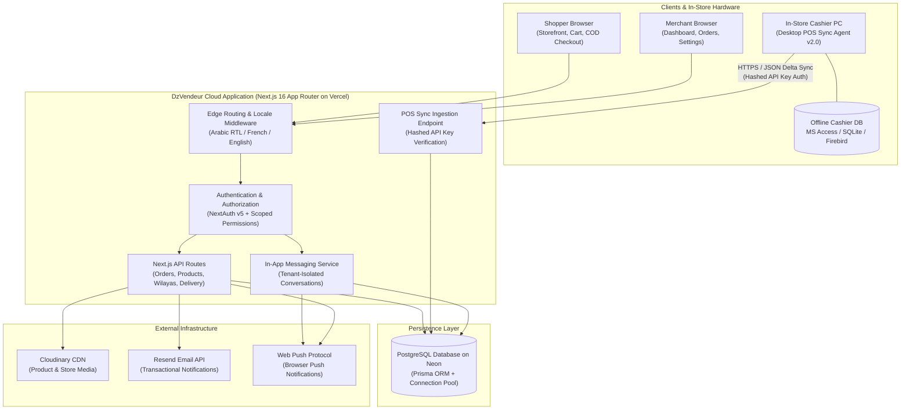

# DzVendeur (dzvendeur.com)

A specialized multi-vendor e-commerce SaaS platform engineered for the Algerian retail economy, bridging physical retail shops with online commerce through automated desktop POS synchronization, native Cash on Delivery (COD) workflows, and 58-wilaya shipping management.

---

## a. Summary & Live Platform

DzVendeur is a commercial e-commerce platform built specifically to address the structural realities of commerce in Algeria. It enables independent merchants to create branded, multilingual online storefronts with Cash on Delivery (COD), configure region-specific shipping rates across all 58 Algerian wilayas, delegate store management through 13 granular staff permissions, and keep online stock levels in sync with local cashier registers via a desktop sync agent. The platform is deployed in production and is publicly testable at https://www.dzvendeur.com.

- **Live Platform URL**: [https://www.dzvendeur.com](https://www.dzvendeur.com)

---

## b. The Problem & Who It Helps

Independent retail businesses in Algeria operate in a unique commercial environment that mainstream global e-commerce platforms (such as Shopify, WooCommerce, or Wix) fail to accommodate:

1. **Payment Gateways Reject Local Cards and CCP**: International e-commerce solutions mandate Stripe, PayPal, or foreign credit cards. In Algeria, international card issuance is severely restricted, and local bank cards (CIB, Edahabia) and postal transfers (Algérie Poste CCP / BaridiMob) cannot be directly processed through foreign SaaS checkouts.
2. **Delivery Pricing Across 58 Wilayas**: Algerian retail relies on Cash on Delivery (COD). Shipping fees vary drastically between coastal cities (e.g., Algiers, Oran), highland regions (e.g., Sétif, Batna), and deep southern Sahara territories (e.g., Tamanrasset, Adrar). Crucially, delivery carriers offer two distinct rates per destination: **Home Delivery** (*à domicile*) and **Stop-Desk / Office Pickup** (*au bureau*). Global platforms only support simplistic flat rates.
3. **Prohibitive Dollar-Priced Software**: Foreign platforms charge monthly subscriptions and per-transaction fees in US Dollars or Euros. In addition to high foreign exchange rates, local merchants lack legal corporate banking mechanisms to pay international recurring software subscriptions.
4. **Offline Retail Inventory Blindspot**: Many independent Algerian retail shops manage sales and inventory using offline Windows desktop software (Microsoft Access `.accdb`/`.mdb`, SQLite, or Firebird). These local systems have no APIs or cloud connectivity. When merchants attempt to sell products online or via social media (Instagram, Facebook), inventory discrepancies inevitably lead to double-selling, out-of-stock orders, customer cancellations, and wasted delivery fees.

**Who DzVendeur Helps**: Independent Algerian merchants, boutique owners, wholesalers, and physical retail shops who need to sell online without abandoning their existing cash register setup or navigating international payment barriers.

---

## c. Verified Platform Features

The following features are fully implemented and verified in the codebase:

- **Merchant Storefront Creation**: Custom subdomain generation (e.g., `storename.dzvendeur.com`), customizable store profile, and public merchant directory.
- **Storefront Customization & Branding**: Curated brand color themes, logo upload, return window policies, minimum order thresholds, and direct social media buttons (WhatsApp, Instagram, Facebook, TikTok, YouTube).
- **Trilingual Localization & RTL**: Native Arabic (default with full Right-to-Left RTL layout), French, and English interfaces across all buyer storefronts and merchant administration panels via `next-intl`.
- **Product Catalog & Variant Management**: Barcode and SKU tracking, multi-image uploads via Cloudinary, categories, stock counts, and multi-attribute variants (color, size/measurement, mark).
- **58-Wilaya Delivery Pricing Matrix**: Granular shipping configuration per store for all 58 Algerian wilayas, supporting separate rates for Home Delivery and Stop-Desk / Post Office pickup, integrated with official commune lists.
- **Cash-on-Delivery (COD) Multi-Step Checkout**: Frictionless buyer checkout without upfront credit card requirements, phone number validation, wilaya/commune cascading selectors, and automatic cart grouping per store.
- **Order Lifecycle & Phone Confirmation Flow**: Order tracking through a strict state machine (`PENDING` → `CONFIRMED` → `SHIPPED` → `COMPLETED`, or `CANCELED` / `RETURNED`). Phone verification support allows staff to adjust line items before dispatch with a 48-hour customer review window.
- **13 Granular Sub-Account Permissions**: Merchant staff delegation allowing store owners to invite employees with fine-grained access limits: viewing orders, managing products, delivery pricing, team management, store settings, subscription management, order confirmation/cancellation, shipping, order completion, returns handling, full order authority, consumer chat, and platform support chat.
- **Desktop POS Synchronization Agent (v2.0)**: Standalone Python desktop application for Windows cashier PCs with a graphical setup wizard. Scans local databases (SQLite, MS Access, Firebird), detects table/column structures, and pushes inventory updates to the cloud using hashed API keys.
- **Direct Merchant-Customer In-App Messaging**: Tenant-isolated live chat between shoppers and store staff, with message sanitization and browser push notifications.
- **Operational Document Generation**: Server-side and client-side PDF invoice and delivery slip generation (`jspdf`, `jspdf-autotable`) and tabular data export to Microsoft Excel (`xlsx`).
- **Audit Logging**: Structured chronological audit logging tracking administrative, merchant, and staff actions.

---

## d. System Architecture



### Architecture Overview

- **Frontend**: Built with **Next.js 16.3.1 App Router** and **React 19.2.8** using Turbopack. Pages are rendered server-side with localized route segments (`/[locale]/...`). Styling is powered by **Tailwind CSS v4** with dedicated Right-to-Left (RTL) styling for Arabic. Every React component follows a strict **≤300-line modularity ceiling** with extracted custom hooks.
- **Backend**: Next.js route handlers (`src/app/api/...`) providing RESTful endpoints. Request bodies pass through central security sanitizers to prevent injection attacks and enforce payload boundaries.
- **Database**: **PostgreSQL** accessed through **Prisma ORM 7.7+** using the `@prisma/adapter-pg` driver adapter with connection pooling for high-concurrency connection stability.
- **Authentication**: **NextAuth.js v5 (Auth.js)** with Credentials provider, bcrypt password hashing (salt rounds: 12), and 30-day JWT sessions. Sub-account permissions are cached on the JWT with a 5-minute database refresh TTL.
- **Hosting & Infrastructure**: The Next.js application is deployed on **Vercel**, with the PostgreSQL database hosted on **Neon**, media assets stored and served via **Cloudinary**, and transactional emails sent via **Resend**.
- **Sync Bot**: Standalone Python 3 application distributed as a 1-click Windows package. It connects locally to the retailer's cashier database (MS Access, SQLite, or Firebird), inspects column mappings, and sends batch updates over HTTPS using hashed API key authentication.
- **Chat System**: Database-backed conversational messaging with tenant isolation rules, real-time polling updates, and Web Push integration.

---

## e. Tech Stack & Tools

### Languages & Frameworks
- **TypeScript 5 & JavaScript (ES2024)**: Full-stack type safety across frontend, API routes, and database models.
- **Next.js 16.3.1 (App Router, Turbopack)**: Modern React full-stack framework with streaming SSR and async layout parameters.
- **React 19.2.8**: Modular component hierarchy with custom hooks separating state logic.
- **Tailwind CSS v4 & `@tailwindcss/postcss`**: Modern CSS utility architecture with bidirectional layout support (RTL/LTR).
- **Python 3**: Powers the desktop POS synchronization agent and database inspection scripts.

### Database & ORM
- **PostgreSQL**: Relational database with foreign key constraints, unique indexing, and cascade rules.
- **Prisma ORM 7.7+**: Type-safe schema, migrations, and query generation using `@prisma/adapter-pg` and `pg.Pool`.

### Services & Libraries
- **Hosting**: Vercel (Next.js production deployment) and Neon (PostgreSQL database).
- **NextAuth.js v5 (Beta 30)**: Authentication, secure cookie management, and role-based session callbacks.
- **next-intl (v4.9)**: Complete internationalization supporting Arabic, French, and English.
- **Cloudinary SDK**: Media processing and authenticated server-side image streaming.
- **Resend**: Transactional emails with localized HTML email templates.
- **Web-Push & VAPID**: Browser-level push notification delivery for order updates and customer messages.
- **jsPDF & jsPDF-AutoTable**: Client and server PDF generation for commercial delivery receipts and invoices.
- **SheetJS (`xlsx`)**: Excel workbook generation for merchant catalog and order reporting.
- **Playwright**: End-to-end automated testing suite for smoke and regression testing.

### AI Tools Disclosure
The project was developed with Google Antigravity (AI coding environment) using Gemini 3.7 Flash and Gemini 3.8 Flash. They assisted in general development tasks including writing and debugging application code, engineering the desktop POS synchronization agent, drafting tests, and writing documentation.

---

## f. Key Operational Flows

### 1. Order and Delivery Status Flow
1. **Order Creation**: The customer selects product variants, chooses their wilaya and commune, selects a delivery method (Home or Stop-Desk), and submits a COD order without entering payment card details.
2. **Pending Stage (`PENDING`)**: The order appears in the merchant's dashboard. A notification email and web push alert are triggered.
3. **Phone Verification & Optional Modification**: The merchant or a delegated staff member calls the customer to verify the delivery address and order intent. If the customer requests changes (e.g., adding another color or changing size), staff records an order modification (`MODIFIED_PENDING`) which initiates a 48-hour confirmation window.
4. **Order Confirmation (`CONFIRMED`)**: Once confirmed, an atomic database transaction (`prisma.$transaction`) validates available stock and decrements inventory for each order line item.
5. **Dispatch (`SHIPPED`)**: The merchant packs the order, prints the PDF delivery slip, and hands the parcel to the delivery courier. The customer receives an automated shipping status alert.
6. **Completion (`COMPLETED`) or Return (`RETURNED` / `CANCELED`)**: When the courier collects cash at the customer's doorstep, the order is marked `COMPLETED`. If the customer rejects the parcel or cancels, the transaction restores the reserved items back to inventory, respecting the store's configured return window days (`returnDaysLimit`).

### 2. Per-Wilaya Shipping Prices
1. In the merchant dashboard under Delivery Pricing, the merchant views a table of all 58 Algerian wilayas (from `01 Adrar` to `58 El Menia`).
2. The merchant enters individual prices for Home Delivery (`homePrice`) and Stop-Desk Pickup (`officePrice`) for each wilaya, or uses bulk update tools to apply flat regional rates (e.g., Algiers center vs. Southern Sahara wilayas).
3. Setting a price to `0` or toggling a wilaya off marks that region as non-deliverable.
4. During buyer checkout, selecting a wilaya makes a dynamic call to `/api/delivery-price`, calculating the exact shipping charge and adjusting the order total in real time.

### 3. Team Roles and Permissions
1. The store owner navigates to Team Management and issues an email invitation with designated permissions selected from 13 granular checkboxes:
   - `permViewOrders`, `permOrderConfirmCancel`, `permOrderShip`, `permOrderComplete`, `permOrderReturn`, `permOrderFull`
   - `permManageProducts`, `permDeliveryPricing`, `permManageTeam`, `permManageSettings`, `permManageSubscription`
   - `permConsumerChat`, `permSupportChat`
2. The recipient accepts the invitation, sets their password, and logs in under the `SUB_ACCOUNT` role.
3. On every request, `getStoreAndPermission` verifies that the staff member belongs to the merchant's store hierarchy and possesses the required flag.
4. `getOrderVisibilityWhere` dynamically scopes database queries so employees only view and interact with orders matching their permission scope.

### 4. Store Customization (Brand Colours, Social Links)
1. The merchant accesses Store Settings and chooses a primary theme color from an accessibility-tested color whitelist (`#10b981` Emerald, `#004ac6` Royal Blue, `#bc4800` Amber, `#7c3aed` Purple).
2. The merchant uploads a store logo, specifies a return policy text, sets maximum items per order, and inputs direct social contact links (WhatsApp phone number, Instagram handle, Facebook page, TikTok handle).
3. The public storefront dynamically renders buttons, badge accents, banners, and chat triggers matching the selected brand palette, and embeds direct one-click WhatsApp contact buttons for customer inquiries.

### 5. Merchant-Customer In-App Chat
1. A prospective customer browsing a storefront clicks the chat icon on a store or product page.
2. The system locates or creates a `MERCHANT_CUSTOMER` conversation record between the customer ID and the store's owner ID.
3. The merchant receives real-time indicators in their dashboard. Sub-accounts with `permConsumerChat` permission can participate in conversations.
4. All messages pass through `sanitizeTextContent` to remove malicious scripts before being stored in PostgreSQL.

### 6. The Desktop POS Sync Script
1. The merchant navigates to Store Settings → API Keys and generates a new secret API key. The plain secret key is presented once; only its cryptographic hash is retained on the server.
2. The merchant downloads the POS Sync Agent ZIP package onto their in-store cashier PC.
3. The merchant double-clicks `Start_Sync_Windows.bat` (or `اضغط_هنا_للتشغيل.bat` in Arabic).
4. A clean graphical wizard opens in their chosen language (Arabic, French, or English). The merchant pastes their API key and selects their cashier database file (e.g., Microsoft Access `.accdb`/`.mdb`, SQLite `.db`, or Firebird `.fdb`).
5. The wizard automatically inspects the database tables, matches the columns (barcode, product name, price, stock), and displays a confirmation.
6. The merchant clicks "Start Syncing". The agent runs silently in the background, polling for inventory changes and sending delta batches over HTTPS to the authenticated sync endpoint. Online stock counts mirror physical sales within seconds.

---

## g. Data Model Overview

The database schema models a multi-tenant e-commerce ecosystem. The primary entities and relationships are:

```
[User] (ADMIN | MERCHANT | SUB_ACCOUNT | CUSTOMER)
  │
  ├── 1:1 ──> [Store] (ownerId)
  │             ├── 1:N ──> [Product] (variants, barcode, stock, price)
  │             ├── 1:N ──> [PriceRule] (per-wilaya shipping pricing)
  │             ├── 1:N ──> [StoreApiKey] (hashed API keys for POS sync)
  │             └── 1:N ──> [Order] (COD order headers)
  │                           ├── 1:N ──> [OrderItem] (line items, variants, qty)
  │                           └── 1:N ──> [OrderModification] (phone call revisions)
  │
  ├── 1:N (Self) ──> Sub-Accounts (parentId -> merchant)
  ├── 1:N ──> [Conversation] ── 1:N ──> [Message]
  └── 1:N ──> [AuditLog] (chronological operational logs)

[Wilaya] (58 Algerian administrative divisions)
  └── 1:N ──> [Commune] (municipalities)
```

- **User**: Represents platform administrators, merchants, customer accounts, and staff sub-accounts with 13 boolean permission toggles.
- **Store**: Core tenant entity linked to a merchant; contains subdomain, branding theme, logo URL, social links, return policies, and operational limits.
- **Product**: Catalog items belonging to a store; stores barcode, SKU, images array, base price, total stock, and variant attribute matrices (JSON).
- **PriceRule**: Composite unique constraint (`storeId` + `wilayaId`) storing Home and Stop-Desk delivery fees for each store and wilaya.
- **Order & OrderItem**: Cash on Delivery customer orders containing customer phone number, wilaya/commune delivery foreign keys, order status enum, timestamps, and line-item snapshots.
- **OrderModification**: Audit trail of revisions made to orders during customer phone confirmations, tracking price differences and expiration timestamps.
- **StoreApiKey**: Cryptographic API credentials for physical store cash registers; stores key prefix, SHA-256 hash, and last-used timestamps.
- **Wilaya & Commune**: Complete reference data for all 58 Algerian wilayas with official codes and trilingual names (Arabic, French, English), paired with their municipal communes.
- **Conversation & Message**: Customer-merchant messaging records with access control policies based on role and store ownership.
- **AuditLog**: Immutable action log capturing user ID, store ID, event name, and JSON metadata.

*(All sensitive fields such as password hashes, verification tokens, and session identifiers are excluded from client queries and external representations).*

---

## h. Security & Engineering Decisions

1. **Hashed API Keys for Physical Hardware**: In-store cash register PCs in retail shops are physically accessible environments. To eliminate the risk of database compromise exposing credentials, store API keys are hashed using SHA-256 prior to storage. Incoming requests are authenticated by hashing the provided header and executing a direct indexed lookup against `keyHash`. Plaintext keys are never stored on the server.
2. **Multi-Tenant Isolation (Anti-IDOR Architecture)**: All merchant endpoints resolve the requesting user's identity through session cookies (`safeParseUserId`). The `getStoreAndPermission` utility traverses parent account hierarchies to verify store ownership before executing any database operation. Sub-accounts cannot access records belonging to other merchants or access features outside their explicitly granted permission flags.
3. **Scoped Query Filtering**: Sub-accounts with restricted order permissions are prevented from retrieving unauthorized orders through database-level `where` clauses (`getOrderVisibilityWhere`), ensuring data isolation at the SQL query level rather than relying on client-side filtering.
4. **Input Sanitization & Injection Defense**: All incoming request bodies pass through `sanitizeRequestBody` and `sanitizeTextContent` helpers before hitting database queries or notifications, protecting against XSS and script injection. Emails are strictly normalized to lowercase before authentication lookups.
5. **Atomic Inventory Transactions**: To prevent race conditions and overselling between online checkout and physical cashier registers, status transitions that alter stock (such as moving an order to `CONFIRMED` or `RETURNED`) are wrapped in Prisma database transactions (`prisma.$transaction`).
6. **Component Modularity & Code Quality**: The frontend follows a strict **≤300-line limit per React component**, separating state management into custom hooks and UI regions into focused subcomponents with zero ESLint warnings.

---

## i. Repository Note & How the Sync Script Works

### Why the Full Source Is Not Public
DzVendeur is a commercial software platform built for the Algerian market. To protect proprietary business logic and commercial assets, the full repository is not publicly published. The organizers of the Thirduni programme confirmed that publishing a comprehensive architectural README, environment specification, and selected production code excerpts is fully acceptable for evaluation. The platform is live and publicly testable at [https://www.dzvendeur.com](https://www.dzvendeur.com). The code excerpts in the [`excerpts/`](excerpts/) directory demonstrate the real engineering implementation.

### How an Algerian Merchant Uses the Sync Script
When an Algerian shop owner registers on DzVendeur:
1. The merchant goes to their store settings dashboard, clicks "Generate Cashier API Key", and copies the generated key.
2. The merchant downloads the POS Sync Agent ZIP file directly from their dashboard onto their physical cash register computer (running Windows).
3. The merchant double-clicks `Start_Sync_Windows.bat` (or `اضغط_هنا_للتشغيل.bat` in Arabic).
4. A clean graphical wizard opens in their chosen language (Arabic, French, or English). The merchant pastes their API key and selects their cashier database file (e.g., Microsoft Access `.accdb`/`.mdb`, SQLite `.db`, or Firebird `.fdb`).
5. The wizard automatically inspects the database tables, matches the columns (barcode, product name, price, stock), and displays a confirmation.
6. The merchant clicks "Start Syncing". The agent runs in the background. Whenever a customer buys an item in the physical shop, the cashier software updates the local database, and within seconds the desktop agent syncs the new stock count to their DzVendeur online store.

---

## j. Team & Roles

DzVendeur is built and operated by a **solo founder & software engineer**:

| Full Name | Role | Responsibilities |
| :--- | :--- | :--- |
| Melati Mohammed Abdel Ilah (`abidoo22`) | Solo Founder & Lead Full-Stack Engineer | Architected, designed, and implemented the entire project end-to-end: Next.js full-stack application, PostgreSQL/Prisma data models, Python desktop POS sync agent, 58-wilaya delivery pricing engine, 13 sub-account permissions, security & tenant isolation controls, and production deployment (developed with Google Antigravity using Gemini 3.7 Flash and Gemini 3.8 Flash). |

---

## k. What Happens Next: 3-Month Plan

- **Month 1**: Integrate direct delivery courier webhooks (Yalidine, Maystro, ZR Express) for automated shipping label generation and real-time parcel tracking from the merchant dashboard.
- **Month 2-3**: Implement automated BaridiMob / CCP transfer reconciliation and launch an Android companion scanner app for physical barcode audits, expanding pilot merchant onboarding across five target commercial wilayas.

---

## l. Prior Work Disclosure

DzVendeur began as a personal project before the Thirduni programme (mid-2026) and was developed further during it. The programme's four weeks began in the first week of September 2026.

### Before the programme (until the end of August 2026)
- Core multi-vendor e-commerce architecture on Next.js and PostgreSQL with trilingual localization (Arabic RTL default, French, English).
- 58-Wilaya shipping pricing matrix (Home delivery vs. Stop-Desk pickup) and Cash on Delivery (COD) order checkout.

### During the programme (from September 2026)
- Standalone desktop POS synchronization agent (v2.0) with local database inspection (SQLite, MS Access, Firebird) and 1-click Windows wizard.
- Browser Web Push notifications (VAPID) and automated Telegram merchant alerts.
- Post-order phone verification and modification workflow (`OrderModification`) with a 48-hour customer review window.
- POS sync agent stability enhancements, merchant catalog quota limits, and database connection improvements.
- Redesigned public marketing landing pages, storefront product category badges, quick activation controls, and branded navigation.
- Configurable inventory stock masking, multi-criteria product sorting, and platform activity tracking.
